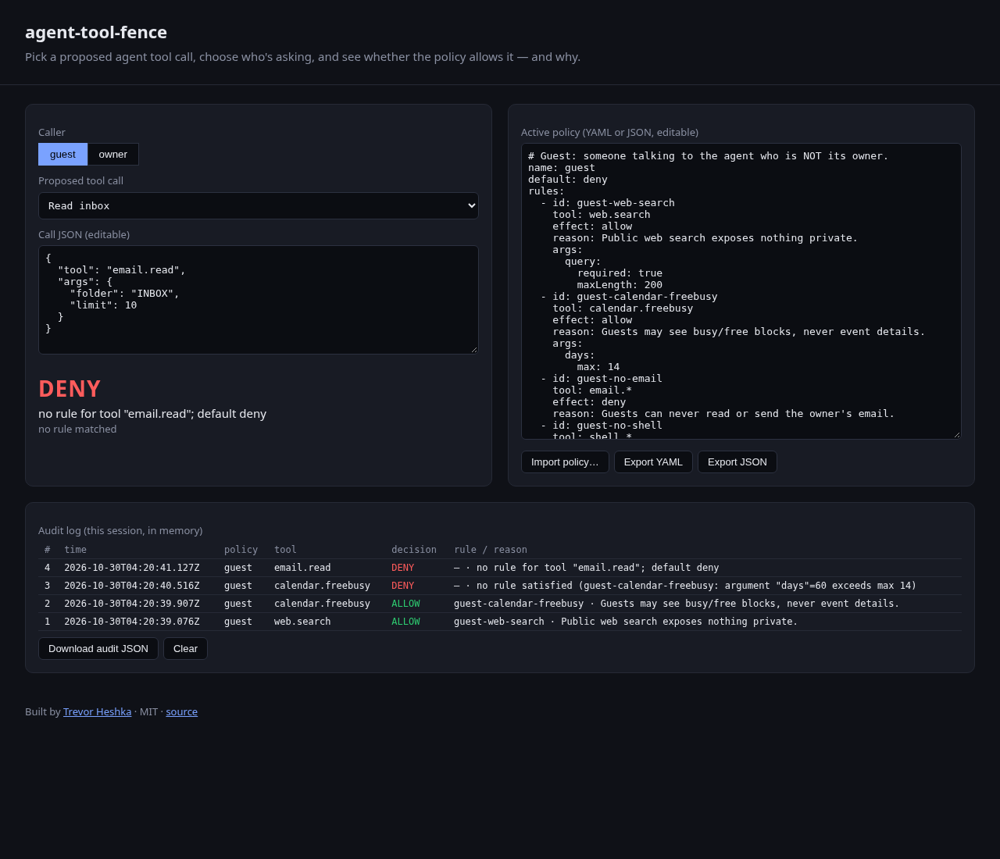
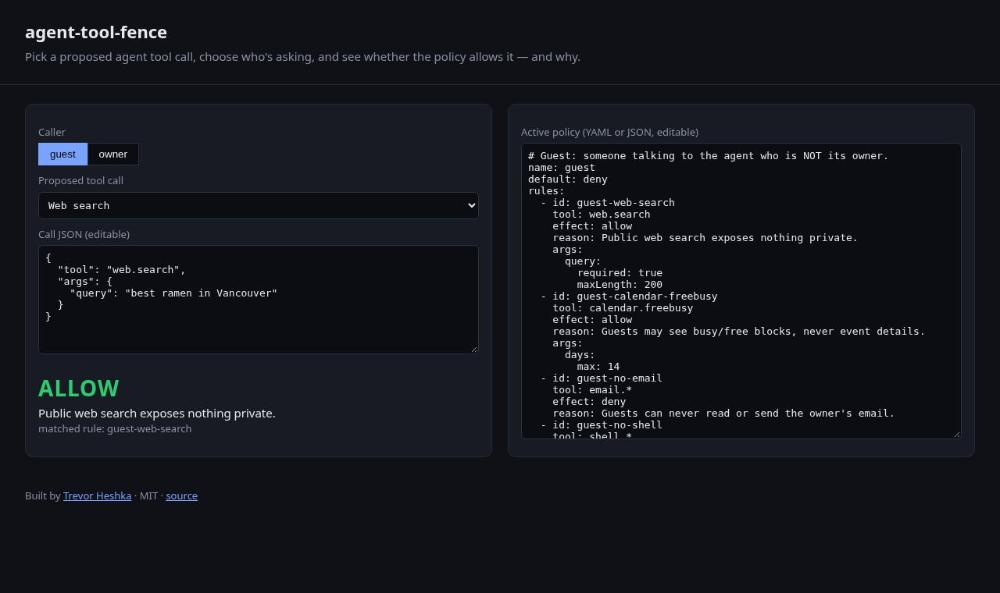
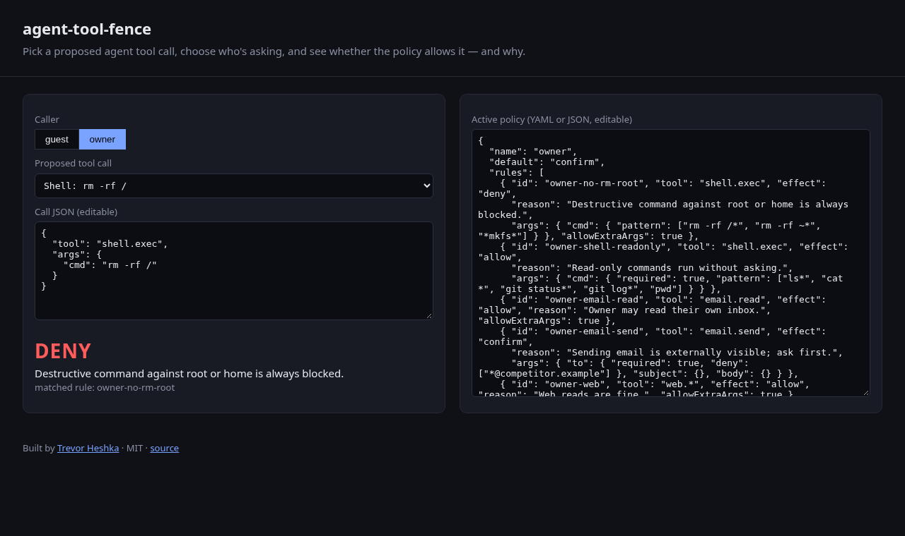
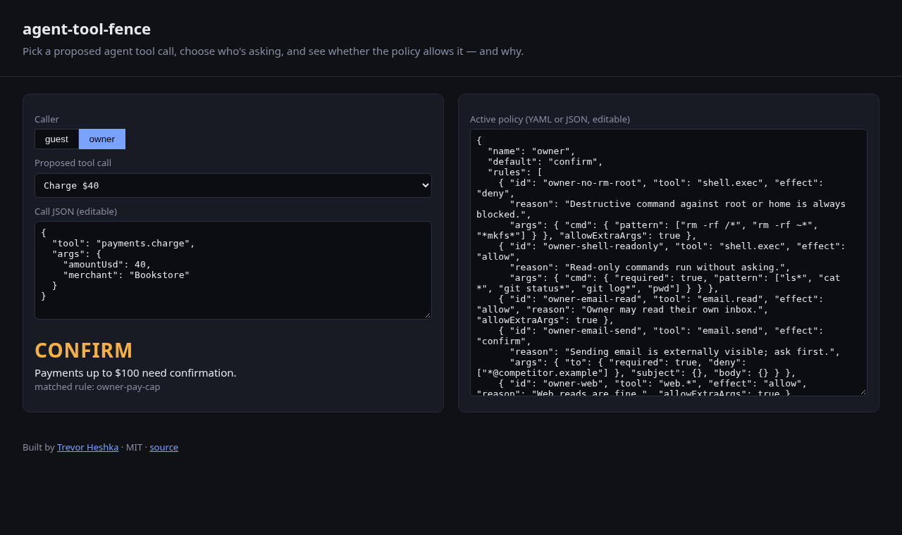

# agent-tool-fence

**Allowlist policies for AI agent tool calls.** Before an agent runs a tool (send email, run a shell command, charge a card), ask the fence. A small YAML or JSON policy decides whether the call is **allowed**, **denied**, or needs **confirmation**, and says why.

Zero runtime dependencies. The same engine runs in Node and in the browser.



| Guest: web search allowed | Owner: `rm -rf /` denied | Owner: $40 charge needs confirmation |
|---|---|---|
|  |  |  |

## Why
Agents that act for one person often talk to other people as well. A guest should be able to ask what the owner's free/busy time is. A guest should not be able to read the owner's inbox. The fence makes those rules explicit, reviewable, and testable, instead of burying them in a prompt.

## Policy format
```yaml
name: guest
default: deny            # allow | deny | confirm when no rule matches
rules:
  - id: guest-calendar-freebusy
    tool: calendar.freebusy   # glob: * and ? supported (e.g. email.*)
    effect: allow             # allow | deny | confirm
    reason: Guests may see busy/free blocks, never event details.
    args:
      days:
        max: 14               # also: required, oneOf, pattern[], deny[], min, maxLength
```
- Deny rules are checked first. A deny rule fires when all of its argument constraints match.
- For allow and confirm rules, the first rule whose constraints are all met wins.
- Arguments the rule doesn't list are rejected unless `allowExtraArgs: true`.
- If nothing matches, the `default` applies. The reason then lists why each candidate rule missed.

Sample policies: [`policies/guest.yaml`](policies/guest.yaml) and [`policies/owner.json`](policies/owner.json).

## Run
Requires Node 18 or newer. There is nothing to install.
```bash
git clone https://github.com/YardPhantom/agent-tool-fence && cd agent-tool-fence
npm start        # demo UI on http://localhost:4173
npm test         # node:test suite
node cli.js policies/guest.yaml '{"tool":"email.read","args":{}}'   # exit 1 on deny
```
To deep-link the demo, use `http://localhost:4173/#as=owner&call=6`.

## Audit log and policy import/export
The demo keeps an in-memory audit log of every decision (ISO-8601 timestamp, policy, tool, args, decision, matched rule, reason). **Download audit JSON** saves it; **Clear** empties it. **Import policy…** loads a `.yaml`/`.yml`/`.json` file into the editor (validated first), and **Export YAML** / **Export JSON** save the current policy.

The same pieces are in the library:

```js
const { createAuditLog, serializePolicy } = require('agent-tool-fence');
const audit = createAuditLog({ max: 1000 });      // bounded, in memory
audit.evaluate(policy, { tool: 'web.search', args: { query: 'x' } });
fs.writeFileSync('audit.json', JSON.stringify(audit.toJSON(), null, 2));
fs.writeFileSync('policy.yaml', serializePolicy(policy, 'yaml')); // or 'json'
```

## Use as a library
```js
const { parsePolicy, evaluate } = require('./src/fence');
const policy = parsePolicy(fs.readFileSync('policies/owner.json', 'utf8'));
evaluate(policy, { tool: 'shell.exec', args: { cmd: 'ls' } });
// → { decision: 'allow', rule: 'owner-shell-readonly', reason: 'Read-only commands run without asking.' }
```
The YAML parser covers a small subset of YAML: block maps, lists, scalars, and inline `[a, b]`. If you need full YAML, use JSON.

## Layout
`src/fence.js` engine · `public/` demo UI (`npm run sync` copies the engine in) · `policies/` samples · `server.js` static server · `cli.js` CLI · `test/` tests

---
Built by [Trevor Heshka](https://trevorheshka.com) · MIT License
